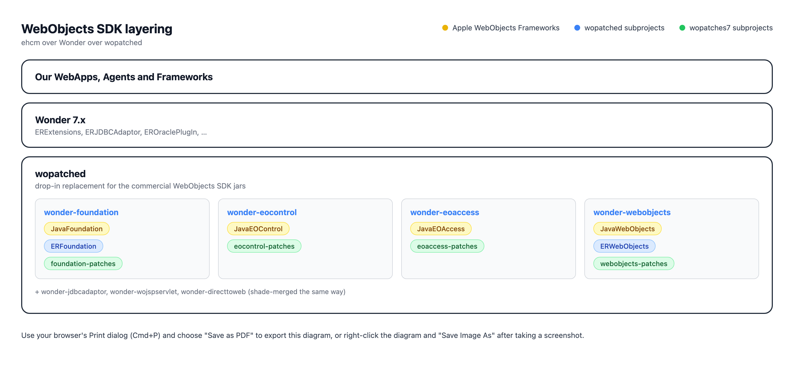

# Wonder 7.x and wopatching

## Overview

One of the longstanding challenges with using Wonder patches is that they rely on **classpath ordering**. The frameworks containing patched classes must appear before the original Apple WebObjects frameworks on the classpath so that the patched implementations are loaded instead of the originals. This dependency ordering must be maintained consistently during development, testing, and production deployment, which can be difficult to manage and troubleshoot.

**wopatching** is an umbrella project hosting both **wopatched** and **wopatches7**:

```
wopatching/
├── wopatches7/   # patch modules (groupId: wopatches7) — built & installed to ~/.m2 first
│   ├── foundation-patches/
│   ├── eocontrol-patches/
│   ├── eoaccess-patches/
│   ├── jdbcadaptor-patches/
│   ├── webobjects-patches/
│   ├── wojspservlet-patches/
│   └── directtoweb-patches/
└── wopatched/    # drop-in WO replacements (groupId: wopatched) — built 2nd, consumes wopatches7
    ├── wonder-foundation/
    ├── wonder-eocontrol/
    ├── wonder-eoaccess/
    ├── wonder-jdbcadaptor/
    ├── wonder-webobjects/
    ├── wonder-wojspservlet/
    └── wonder-directtoweb/
```

Only `wopatched`'s artifacts should be published; `wopatches7`'s artifacts are a build-time-only dependency, installed to `~/.m2/repository` and then consumed locally by `wopatched`.

**wopatched** provides drop-in replacements for the original Apple WebObjects frameworks, with commonly used Wonder patches and fixes from **ERFoundation** and **ERWebObjects** already integrated. It also includes a patched version of `NSStandardProjectBundle`, originally developed for wopatches7, which replaces the implementation shipped with ERFoundation. The purpose of this patch is to correctly distinguish between Maven and Fluffy Bunny project layouts. 

**ERFoundation 1.0** relies on the retired Eclipse nature ID `org.maven.ide.eclipse.maven2Nature`, which modern Eclipse releases no longer write, causing all projects to be treated as Fluffy Bunny projects. 

**ERFoundation 1.2** instead checks for `org.eclipse.m2e.core.maven2Nature`, which is present on nearly all m2e-managed projects, including traditional WebObjects projects that still use `Sources`, `Resources`, `Components`, and `WebServerResources`. As a result, those projects are incorrectly classified as Maven projects, causing resources such as `Info.plist` and `Properties` to be searched for under `src/main`, where they do not exist. Startup subsequently fails because `mainBundleName` cannot be resolved.

The patched implementation determines the project type primarily from the project directory structure rather than the Eclipse nature ID. Projects containing a `Resources` directory together with `Components` or `WebServerResources` are treated as Fluffy Bunny projects. Projects containing `src/main/java`, `src/main/resources`, or `src/main/woresources` are treated as Maven projects. Only when neither layout is present does the code fall back to examining the Eclipse nature ID, recognizing both the retired `org.maven.ide.eclipse.maven2Nature` and the current `org.eclipse.m2e.core.maven2Nature`.

The shaded `wonder-foundation` JAR included with **wopatched** uses this implementation.

The generated artifacts by **wopatched** include: wonder-foundation, wonder-eocontrol, wonder-eoaccess, wonder-webobjects, wonder-jdbcadaptor, etc.

The patch modules are maintained in a separate project called **wopatches7**. This project consolidates patches that are currently distributed across several Wonder frameworks, primarily **ERExtensions**, but also frameworks such as **ERAttributeExtension**, into dedicated patch libraries: foundation-patches, eocontrol-patches, eoaccess-patches, webobjects-patches, jdbcadaptor-patches, etc.

This approach separates patch development from patch consumption.

**wopatches7** serves as the source of the patches, while **wopatched** consumes **wopatches7** and produces a set of WebObjects-compatible framework replacements that already contain those patches, eliminating classpath-ordering concerns during both development and runtime.



**Note:** In this process the ~~JavaXML~~ framework is eliminated.

## Dropping `JavaXML` from `wopatched`/`wonder-7.x`

`com.webobjects:JavaXML` is a ~14 MB, 4,475-class commercial jar from 2005–2008 that embeds the entire legacy SOAP stack — Apache Axis 1.x, WSDL4J, Xalan, Xerces, BCEL, old Log4j 1.x, Commons Discovery, and a servlet/JSP API shim — none of which is needed for ordinary XML parsing, since `javax.xml.*`/`org.w3c.dom`/`org.xml.sax` have shipped natively in the JDK's `java.xml` module for years.

An exhaustive scan was run of all 315 classes in `JavaWebObjects.jar` for references to JavaXML-exclusive packages and found only 15 hits:

* 3 (`WOXMLCoder`, `WOXMLDecoder`, `WOCGIFormValues$Encoder`) were already neutralized by the `webobjects-patches` module (which replaced their Xerces-specific `Base64` usage with `java.util.Base64`), and
* the remaining 12 were the dead legacy Axis-based `WOWebService`/WSDD/RPC direct-action subsystem — confirmed unused in practice (Wonder's own `WOWebServicePatch.initServer()` call is a no-op unless a `server.wsdd` resource exists, which none of our apps ship).

This matches the precedent already set by `wonder-modular-webobjects`.

* `wopatched` removed the `com.webobjects:JavaXML` dependency from the parent `dependencyManagement`, from `wonder-webobjects`, and from `wonder-wojspservlet`. `wonder-wojspservlet` needed nothing further: a scan of all 13 classes in `JavaWOJSPServlet` found no reference to a JavaXML-only package. `wonder-webobjects` excludes the dead Axis-based `WOWebService`/`WSDD`/`RPC` classes from the shade merge, since no patched replacement exists. The filter matches `wonder-modular-webobjects` for `_WODocumentType`, `_WOMessageHelper`, `WOWSDDRegistrar`, `WOWSDDRegistrar$Delegate`, `WOWebServiceRegistrar`, `WOWebServiceUtilities`, `WOAxisSession`, `WOComponentSerializer`, `WOComponentSerializerFactory`, `WORPCProvider`, `WOServerSessionHandler`, `WOWebService`, and `WOWebService$NullTransformer`. `WOWebServiceRequestHandler` stays in the jar because `WOApplication._registerRequestHandlers()` names that type in bytecode. The same filter also drops the stray root-package `KeyValueCodingProtectedAccessor.class`; `webobjects-patches` supplies the correctly packaged copy.
* `wonder-7.3.11` commit `c75b206de` ("Remove WOWebServicePatch (legacy Axis-based SOAP webservices support)") on `feature/wonder-7.3.11` removed `WOWebServicePatch.java` and its `ERXApplication.initFinish()` call site. That commit is in the Wonder repository.
* `wonder-directtoweb`'s plain pass-through dependencies on `com.webobjects:JavaEOProject`/`JavaDTWGeneration` (see the module table in Status below) were silently reintroducing the raw, unpatched `JavaWebObjects` → `JavaXML`/`JavaEOControl` and `JavaEOAccess` → `JavaFoundation` chain transitively, since those two pass-through artifacts' own published poms declare that chain and — unlike every other `wopatched` module's own shaded jar — were not marked `optional`. Fixed with explicit `<exclusions>` on both, so only the already-patched sibling `wopatched` modules supply those classes.

## Similar to Wonder 8 and womodular

This is conceptually similar to how **Wonder 8** introduces **wopatches** and **womodular**.

   - wonder 7.3.11 (our fork) is analog to wonder8 (without java modules)
   - wopatched is analog to womodular (without java modules and without redesigned NSBundle stuff)
   - wopatches7 is analog to wopatches (without java modules)

## Methodology

`wopatches` contains 59 Java source files across 7 Maven modules (`foundation-patches`, `eocontrol-patches`, `eoaccess-patches`, `jdbcadaptor-patches`, `webobjects-patches`, `wojspservlet-patches`, `directtoweb-patches`). Each file shadows a real `com.webobjects.*` class, and in many cases **wonder's own tree also carries an equivalent in-tree patch class** for the same purpose (wonder currently achieves its override via framework load order rather than a separate shaded jar). All 59 files were reviewed one by one, comparing the `wopatches` version against wonder's in-tree version (where one exists) to decide which to carry forward into `wopatches7`.

Each file fell into one of these buckets:

1. **Identical** (9 files) — `wopatches` and wonder have the exact same content. Trivial: copy either into `wopatches7`.
2. **Different** (23 files) — both projects have a version of the file, but they differ. Required a full review (see below).
3. **No match in wonder** (27 files) — `wopatches` has a file with no wonder in-tree counterpart at all. Subdivided into:
   - 8 **standalone gap-fillers**
   - 3 **relocated utility classes** (pulled in as transitive dependencies of other chosen files)
   - 16 files belonging to a **wonder8-style NSBundle/WOBundle redesign cluster** — excluded (this 16 includes `NSValueUtilities.java`, which is superseded by the `ERFoundation`/`ERWebObjects` binary dependencies — see below)

### Review process for "different" files

For each of the 23 files with diverging content, a consistent investigative method was used:

1. Grep both versions for `^import er\.` — an upward dependency on a higher-level Wonder framework class (`er.extensions.*`, `er.directtoweb.*`) from a low-level foundation/webobjects-layer patch class is an architectural smell: these patch classes are meant to be loadable standalone, underneath Wonder, not dependent on it.
2. Raw `diff`, then `diff -w -B` (ignoring whitespace/blank lines) to isolate the substantive differences from cosmetic ones.
3. For files with large diffs, extracted and compared method-signature sets to quickly spot added/removed/changed methods.
4. Where needed, inspected the **real commercial `.class` files** (`javap -c -p`) from the actual `com.webobjects:*:5.4.3` jars to confirm claims like "this class depends on a deprecated/internal API in the original," and searched `main` branch in our code base for real-world call-site usage to gauge risk before deciding.

### Disqualifying patterns we relied on

Across the 23 files, these patterns recurred and became our decision criteria (roughly in order of how often they appeared):

* **Upward imports** — a foundation/webobjects-layer class importing `er.extensions.*` or `er.directtoweb.*`. Disqualifies that version from being a standalone, classpath-shadowing patch class.
* **Unnecessary third-party dependencies** introduced in low-level patch classes that have no business needing them — e.g. `org.slf4j.Logger` instead of the classic `com.webobjects.foundation.NSLog`, or `org.apache.commons.lang3.CharEncoding` instead of `java.nio.charset.StandardCharsets`.
* **Sideways package dependencies** — e.g. `com.webobjects.eoaccess.EOAttribute` throwing `com.webobjects.jdbcadaptor.JDBCAdaptorException` instead of the adaptor-agnostic `com.webobjects.eoaccess.EOGeneralAdaptorException` (confirmed by checking which package each exception class actually lives in).
* **Dead/stub code** — e.g. wonder's `EOAttribute.setChangeNotificationOptions(...)`/`changeNotificationOptions()` turned out to be no-op stubs referencing a class that doesn't correspond to any real WebObjects 5.4.3 jar class, and confirmed unused by our code base. Safe to drop.
* **False alarms** — several diffs looked substantive but were confirmed logically/behaviorally equivalent on inspection (e.g. `if/else` vs. two sequential `if` returns, `Integer.parseInt` vs. `Integer.valueOf` immediately unboxed). These were not treated as a reason to prefer one side.

### Decisions for the 23 "different" files

| Module | File | Chosen source | Why |
| --- | --- | --- | --- |
| foundation-patches | `NSArray.java` | wopatches | wonder's version carries an upward dependency pattern similar to `ERXKey`/enhancement style changes not needed for a standalone patch class |
| foundation-patches | `NSDictionary.java` | wonder | Null-handling difference confirmed to pose zero real-world risk in our code base (zero call sites use the affected 2-arg `(Map, boolean)` constructor) |
| foundation-patches | `NSMutableArray.java` | wonder | `wopatches` diff was logically redundant but behaviorally identical (`else` vs `else if (!identical)`) — no reason to deviate from wonder |
| foundation-patches | `NSMutableSet.java` | wonder | Diff confirmed equivalent (`(removeObject(o) != null) == true` vs. equivalent ternary) |
| foundation-patches | `NSMutableDictionary.java` | wonder | No substantive difference found favoring `wopatches` |
| foundation-patches | `_NSWeakMutableArray.java` | wonder | No substantive difference found favoring `wopatches` |
| foundation-patches | `NSSet.java` | wonder | `if/if` vs `if/else-if` confirmed equivalent since the first branch always returns |
| eoaccess-patches | `ERXAdaptorOpComparator.java` | wonder | No substantive difference found favoring `wopatches` |
| eoaccess-patches | `ERXEntityDependencyOrderingDelegate.java` | wopatches | Cleaner implementation; pulls in the 3 relocated utility classes (see below) |
| eoaccess-patches | `_EOExpressionArray.java` | wonder | `if(A\|\|B) return true` vs. two sequential `if` returns confirmed equivalent |
| eoaccess-patches | `ERXEntity.java` | wonder | `Integer.parseInt` vs `Integer.valueOf` confirmed equivalent (immediately unboxed) |
| eoaccess-patches | `ERXSingleValueID.java` | wopatches | Preferred implementation, no upward dependency issues |
| eoaccess-patches | `ERXModel.java` | wopatches | Preferred implementation, no upward dependency issues |
| eoaccess-patches | `EOAttribute.java` | wopatches | wonder's version throws the sideways-dependency `JDBCAdaptorException` from an eoaccess-layer class instead of the adaptor-agnostic `EOGeneralAdaptorException`; also drops wonder's dead `changeNotificationOptions` stub methods. wonder's genuinely useful `newValueForNumber` enhancement was confirmed as a real addition (not in the original class) and is preserved |
| eocontrol-patches | `KeyValueCodingProtectedAccessor.java` | wonder | No substantive difference found favoring `wopatches` |
| eocontrol-patches | `_EOIntegralKeyGlobalID.java` | wonder | No substantive difference found favoring `wopatches` |
| eocontrol-patches | `_EOCheapCopyArray.java` | wonder | No substantive difference found favoring `wopatches` |
| eocontrol-patches | `_EOCheapCopyMutableArray.java` | wonder | No substantive difference found favoring `wopatches` |
| jdbcadaptor-patches | `ERXJDBCColumn.java` | wopatches | Preferred implementation, no upward dependency issues |
| webobjects-patches | `WOCGIFormValues.java` | wopatches | Preferred implementation, no upward dependency issues |
| directtoweb-patches | `D2WPage.java` | wopatches | Preferred implementation, no upward dependency issues |
| directtoweb-patches | `ERD2WContext.java` | wonder | No substantive difference found favoring `wopatches` |
| directtoweb-patches | `ERD2WUtilities.java` | wopatches | Preferred implementation, no upward dependency issues |

**Totals: 9 from `wopatches`, 14 from wonder.**

### The 8 standalone gap-filler files

These `wopatches` files have **no wonder in-tree counterpart at all** — wonder doesn't currently patch these classes by any means. All 8 were reviewed and **adopted as-is from `wopatches`** because each one either removes a genuine, confirmed legacy/deprecated dependency that the real commercial class carries (replacing it with a standard JDK/JAXP/NIO equivalent), or fixes a genuine security gap in the original — in all cases with no upward `er.*` imports introduced:

| File | Legacy dependency / gap in the real commercial class (confirmed via `javap -c -p` on the actual jar) | Replacement in `wopatches` |
| --- | --- | --- |
| `NSLog.java` | Apache log4j 1.x | Pure-JDK `PrintStreamLogger`; the old `Log4JLogger` class is kept only as an inert no-op stub for API/source compatibility |
| `NSPathUtilities.java` | Raw `java.net.URL`/`JarURLConnection`-based path/URI handling (`URL.getFile()`, `JarURLConnection.getJarFile()`, `File.createTempFile()`) | Rewritten on modern `java.nio.file` APIs (`Path`, `Files`, `FileSystems`, `URI`) |
| `xml/NSXMLOutputFormat.java` | `org.apache.xml.serialize.OutputFormat` (deprecated, non-standard Xerces 1.x/2.x internal serialization API) | Standard JAXP (`javax.xml.transform.*`) |
| `xml/NSXMLOutputStream.java` | `org.apache.xml.serialize.XMLSerializer` (same deprecated internal Xerces API) | Standard JAXP (`javax.xml.transform.*`) |
| `xml/WOXMLCoder.java` | `org.apache.xerces.impl.dv.util.Base64` (internal, non-public Xerces class) | `java.util.Base64` (standard since Java 8) |
| `xml/WOXMLDecoder.java` | Same internal Xerces `Base64` class for decoding | `java.util.Base64` (standard since Java 8). Note: the default SAX parser class name field still defaults to the string `"org.apache.xerces.parsers.SAXParser"` (same literal default as the original), but this is just a configurable default — it's overridable at runtime via `setParserClassName(...)`, so it's not a hard compile-time dependency the way the `OutputFormat`/`Base64` issues were |
| `_private/WOResourceRequestHandler.java` | **Security gap, not a legacy dependency**: confirmed via `javap -p` that the real commercial class has **no access-control logic at all** in `handleRequest`/`_responseForDataAtURL`/`_responseForJavaClassAtPath` — it will serve any requested resource path as-is | Adds a `DEFAULT_AUTHORIZER` that denies serving sensitive resource files (`.plist`, `.eomodeld`, `.properties`, `.class`, `.strings`, `.sh`, `.d2wmodel`, `.api`, etc.) and sensitive directories (`.wo`, `.eomodel`) |
| `ERXEnhancedJDBCColumn.java` | N/A — not a patch at all, this is a genuinely **new** Wonder-style class with no real commercial counterpart | Self-contained subclass of `ERXJDBCColumn` (the `wopatches` version of which we already selected above) adding custom date-type support in `_fetchValue` |

As a specific validation: wonder's `ERXNSLogSlf4jBridge` (installed from `ERXApplication`/`ERXLoggingUtilities` to route `NSLog` output through SLF4J) extends `NSLog.PrintStreamLogger` and calls `NSLog.setOut/setErr/setDebug(...)`. We confirmed all of these APIs are unchanged in `wopatches`' `NSLog.java` (same class hierarchy, same method signatures), and that nothing in wonder references the old `NSLog.Log4JLogger` class by type. **The SLF4J bridge continues to work unmodified** once `wopatches7`'s `NSLog` is on the classpath.

### The 3 relocated utility classes

`ERXEntityFKConstraintOrder.java`, `ERXEntityOrder.java`, and `ERXConstant.java` have no wonder in-tree counterpart in the eoaccess-patches location, but are hard compile-time dependencies of `ERXEntityDependencyOrderingDelegate.java` and `ERXJDBCColumn.java` (both selected from `wopatches` above). They're carried into `wopatches7` as-is, as a consequence of those selections.

### Excluded: the wonder8 NSBundle/WOBundle redesign cluster (16 files)

`wopatches` contains a 16-file cluster implementing a redesigned `NSBundle`/`WOBundle`/development-services subsystem (a wonder8-style rework), including `NSBundle.java`, `NSValueUtilities.java`, `NSNestedProperties.java`, `_NSPathUtils.java`, `WOApplication.java`, `WOResourceManager.java`, `_private/WODeployedBundle.java`, `_private/WOProjectBundle.java`, `_ideservices/_WOLaunchServices.java`, and the `foundation/development/*` bundle-adaptor classes (`CFBundleAdaptor`, `JarBundleAdaptor`, `JigsawBundleAdaptor`, `JigsawJarBundleAdaptor`, `MavenFluffyBunnyProjectAdaptor`, `NSBundleAdaptorProvider`, `NSBundleInfo`). We're **excluding this cluster entirely** from `wopatches7` — see the next section for why.

## Role of `ERFoundation` and `ERWebObjects` in `wopatched`

While investigating the excluded 16-file NSBundle cluster, we discovered that wonder's own `ERExtensions/pom.xml` already has live, frozen-version dependencies on two framework jars published to Maven Central:

* `wonder.core:ERFoundation:1.0`
* `wonder.core:ERWebObjects:1.0`

These jars supply classes like `NSBundle`, `WOBundle`, `WODeployedBundle`, `WOProjectBundle`, `NSForwardException`, `NSProperties`, `_NSStringUtilities`, `_NSUtilities`, `NSSizeLimitedLinkedHashMap`, `NSVersion`, `_NSFileUtilities`, the `_ideservices` package, and more — i.e. **wonder has no in-tree source at all** for this whole area; it already depends on these two binary jars for it. There is no published sources jar; we decompiled both with CFR 0.152 to confirm their contents.

**Decision:** rather than re-sourcing this functionality into `wopatches7`, `ERFoundation:1.0` and `ERWebObjects:1.0` will be kept as **binary jar dependencies feeding directly into `wopatched`'s shade merge** — alongside the original `com.webobjects:*:5.4.3` jars and the corresponding `wopatches7` patch jar. Concretely:

* `wopatched`'s `foundation` module merges: `com.webobjects:JavaFoundation:5.4.3` + `wonder.core:ERFoundation:1.0` + `wopatches7:foundation-patches`
* `wopatched`'s `webobjects` module merges: `com.webobjects:JavaWebObjects:5.4.3` + `wonder.core:ERWebObjects:1.0` + `wopatches7:webobjects-patches`

This is why the 16-file NSBundle redesign cluster in `wopatches` is excluded (its job is already done, with a shipped/frozen binary) — including `NSValueUtilities.java`, which is moot since `ERFoundation:1.0` already supplies that class.

## Status

**Both `wopatches7` and `wopatched` are written and built in this repository, and `com.webobjects:JavaXML` is dropped entirely (see above).**

The triage and the shade merge were first committed in the standalone repositories, then copied here by `bbd11fa`. Those earlier hashes are in the standalone repos, not in `wopatching`'s history.

`wopatches7` (standalone commit `30811bb`): all 59 original `wopatches` files triaged and reconciled (9 identical, 9 kept from `wopatches`, 14 kept from wonder, 3 relocated utilities, 8 standalone gap-fillers, 16 excluded). `mvn clean compile` succeeds, all 8 modules.

`wopatched` (standalone commit `2bafcca`, then `a745f3a`): 7 modules, each a `maven-shade-plugin`-only merge producing a drop-in replacement for the corresponding `com.webobjects:*:5.4.3` jar:

| Module | Merges |
| --- | --- |
| `foundation` | `JavaFoundation` + `ERFoundation` + `foundation-patches` |
| `eocontrol` | `JavaEOControl` + `eocontrol-patches` |
| `eoaccess` | `JavaEOAccess` + `eoaccess-patches` |
| `jdbcadaptor` | `JavaJDBCAdaptor` + `jdbcadaptor-patches` (purely additive, no class overlap) |
| `webobjects` | `JavaWebObjects` + `ERWebObjects` + `webobjects-patches` |
| `wojspservlet` | `JavaWOJSPServlet` + `wojspservlet-patches` |
| `directtoweb` | `JavaDirectToWeb` + `directtoweb-patches` (+ `JavaEOProject`/`JavaDTWGeneration` as plain pass-throughs) |

Each module's `<artifactSet><includes>` is restricted to just that module's own layer, so sibling layers pulled in transitively for compilation (e.g. `foundation-patches` needed by `eocontrol-patches`) aren't redundantly re-merged into every jar. Instead, each `wopatched` module declares a normal (non-shaded) runtime dependency on its sibling `wopatched` modules, mirroring the real `JavaEOControl`→`JavaFoundation`-style dependency chain of the original SDK.

Override precedence is made deterministic via explicit `<filters><excludes>` per module, computed from actual jar class-listing diffs (not guesswork) — e.g. the `foundation` module excludes 31 classes overridden by `foundation-patches` plus 18 classes overridden by `ERFoundation` from the original `JavaFoundation` jar. The stale `META-INF/INDEX.LIST` jar index is also stripped from every original jar. As described above, `com.webobjects:JavaXML` is no longer a dependency of the `webobjects` module at all — it was dropped entirely in standalone `wopatched` commit `a745f3a`, with the 12 dead legacy webservices classes it made reachable excluded from the merge (one, `WOWebServiceRequestHandler`, is kept due to a hard bytecode-level reference from `WOApplication`).

**Verification:** `mvn clean package` succeeds for both projects. Override precedence was confirmed via MD5 checksum comparison — for one representative overridden class per module (plus the `ERWebObjects`-vs-`JavaWebObjects` `WOBundle` case), the class inside the final merged jar byte-for-byte matches the overriding source (patches or `ERFoundation`/`ERWebObjects`) and differs from the original commercial class.
